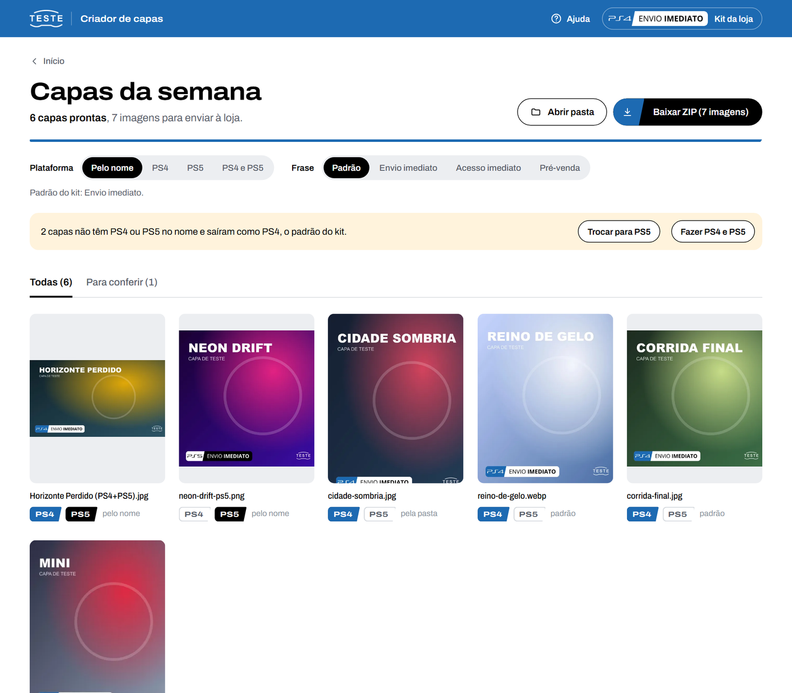
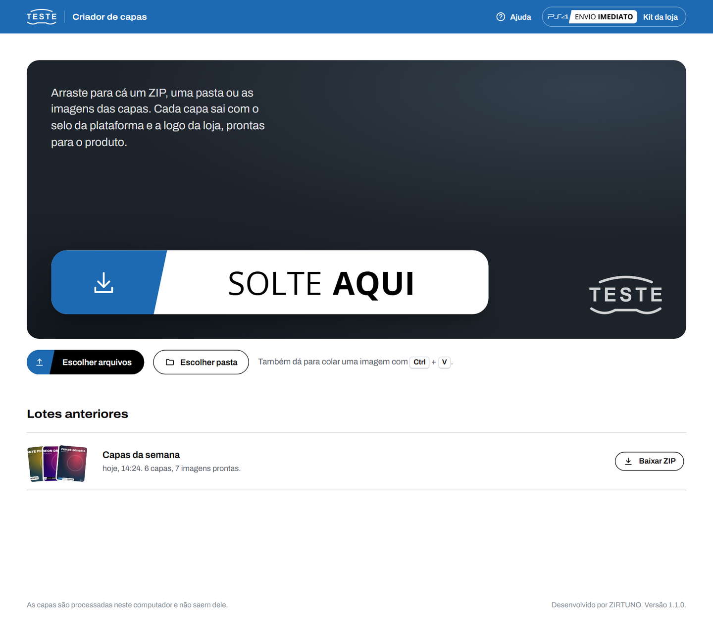
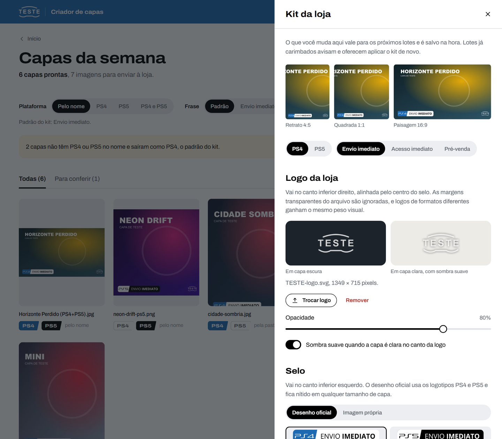

# CoverBatch Studio

**Carimba capas de jogos em lote, para a loja virtual.** Você solta um ZIP, uma pasta ou as imagens; cada capa sai com o selo da plataforma no canto inferior esquerdo e a logo da loja no direito, sempre na mesma posição e proporção. Tudo roda no próprio computador, sem internet e sem conta.

<p>
  <a href="https://github.com/ZIRTUNO/coverbatch-studio/releases/latest/download/Instalar-CoverBatch-Studio.exe"></a>
  &nbsp;
  <a href="https://github.com/ZIRTUNO/coverbatch-studio/releases/latest/download/CoverBatch-Studio-macOS.zip"></a>
</p>



## O que ele faz

- **Selo oficial**: os logotipos PS4 e PS5 com a frase escolhida, **Envio imediato**, **Acesso imediato** ou **Pré-venda**. PS4 com o bloco azul; PS5 no preto e branco oficial. Desenhado em vetor, nítido em qualquer tamanho de capa.
- **Logo da loja** no canto oposto, alinhada pelo centro do selo. Logos largas ou quadradas ganham o mesmo peso visual, e uma sombra suave aparece onde a capa é clara.
- **PS4 ou PS5 pelo nome**: `fc-27-ps4.jpg`, a pasta `PS5/`, `jogo-ps4-ps5.jpg` (sai nas duas) ou o nome do ZIP. Sem indicação, vale o padrão do kit, com aviso e troca em um clique.
- **Formato da imagem**: **Original** (a capa inteira, no formato em que veio; as da PlayStation Store são quadradas) ou um formato fixo: **Retrato 4:5** (1200 × 1500), **Quadrada 1:1**, **Retrato 3:4**, **Retrato 2:3**, **Paisagem 16:9** ou **Story 9:16**. Vale para o lote inteiro ou só para uma capa, e o selo mantém o mesmo peso em qualquer formato.
- **Enquadramento livre**: título cortado? Na capa aberta, **Ajustar enquadramento** deixa arrastar a arte e dar zoom, com o selo e a logo à vista no lugar final. **Capa inteira** mostra a arte toda e completa as sobras com um fundo desfocado feito da própria arte; dá para usar no lote inteiro.
- **Avisos que poupam retrabalho**: capa que parece já ter o selo, resolução baixa, arquivo que não abre. Uma falha nunca interrompe o lote.
- **Pronto para a loja**: um ZIP com nomes limpos (`ea-sports-fc-27-ps4.jpg`), em JPEG ou PNG.

## Como usar

1. **Solte as capas** na janela: um ZIP, uma pasta (com subpastas) ou várias imagens. Também dá para colar uma imagem com Ctrl+V (Cmd+V no Mac).
2. **Confira.** As capas aparecem prontas, uma a uma. Clique numa para comparar sem e com o selo; a plataforma, a frase e o formato podem ser trocados no lote inteiro ou só numa capa, e **Ajustar enquadramento** acerta o que aparece. **Desfazer escolhas** volta o lote ao automático, sem mexer nos enquadramentos ajustados.
3. **Baixe o ZIP** ou abra a pasta com as imagens prontas.

O botão **Ajuda** (ou a tecla `?`) explica cada função.



## Kit da loja

O que a loja define uma vez fica no **Kit da loja**: a logo, os seis selos (PS4 e PS5 com as três frases) e seus textos e cores, a frase padrão de cada plataforma, a posição e o tamanho de cada elemento e, nas imagens finais, o formato padrão, o encaixe (preencher ou capa inteira) e o tipo de arquivo. As prévias mostram o resultado em capas retrato, quadrada e paisagem.

Cada parte alterada ganha **Restaurar original**, e **Restaurar tudo** volta ao kit que veio instalado. Logo depois de restaurar, **Desfazer** traz as alterações de volta. Para levar o kit a outro computador, use **Exportar kit** e **Importar kit**.



## Instalar

**Windows 10 e 11 (64 bits).** Abra `Instalar-CoverBatch-Studio.exe` e clique em **Instalar**; não pede senha de administrador. Se o Windows mostrar "O Windows protegeu o computador", clique em **Mais informações** e em **Executar assim mesmo**. Depois, abra pelo atalho no menu Iniciar. Sem instalar: extraia `CoverBatch-Studio-Windows-x64.zip` e abra `CoverBatch Studio.exe`.

**Mac (macOS 11 ou mais novo, chip Apple ou Intel).** Abra `CoverBatch-Studio-macOS.zip` e arraste o app para o atalho **Aplicativos**. Na primeira abertura, o Mac pede uma confirmação: no macOS 15 ou mais novo, em **Ajustes do Sistema > Privacidade e Segurança > Abrir Mesmo Assim**; do 11 ao 14, com **clique direito > Abrir**.

Cada download traz **Como instalar.html**, o passo a passo com desenhos das telas, e não precisa de mais nada instalado: o Node.js vai junto. A interface abre numa janela própria; fechar a janela encerra o programa. Para atualizar, instale a versão nova por cima: os lotes e o kit são mantidos.

## Privacidade

As capas são processadas no próprio computador e nunca saem dele. O programa não usa internet: o servidor local só aceita conexões da própria máquina, com token por sessão. Os arquivos que você solta nunca são alterados; as imagens prontas são cópias novas.

## Para desenvolvedores

Node.js 22 ou mais recente:

```powershell
npm ci
npm start
npm test
```

Testes, pacotes de Windows e Mac, edição privada e estrutura do código: [docs/DESENVOLVIMENTO.md](docs/DESENVOLVIMENTO.md).

---

Desenvolvido por ZIRTUNO. Os logotipos PS4 e PS5 são marcas da Sony Interactive Entertainment, usados só para identificar a plataforma de cada jogo.
